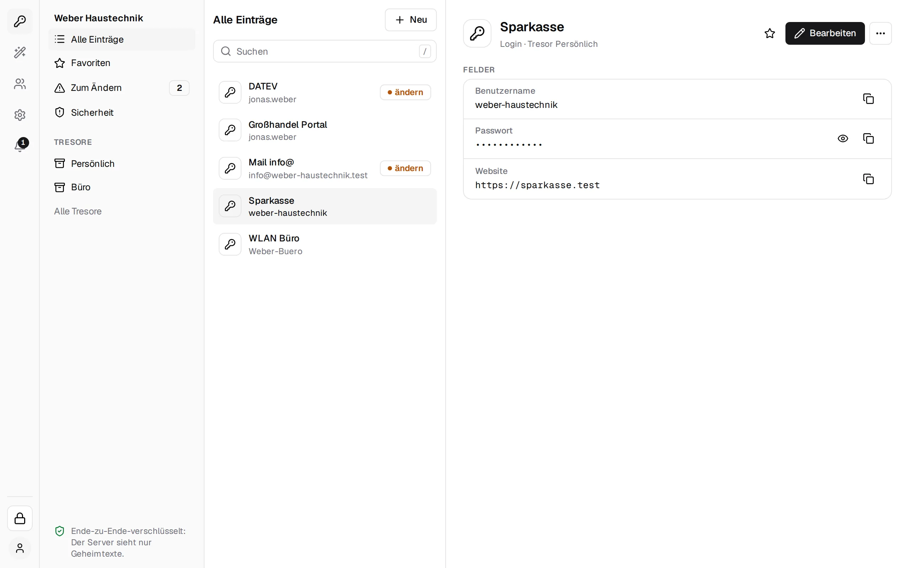
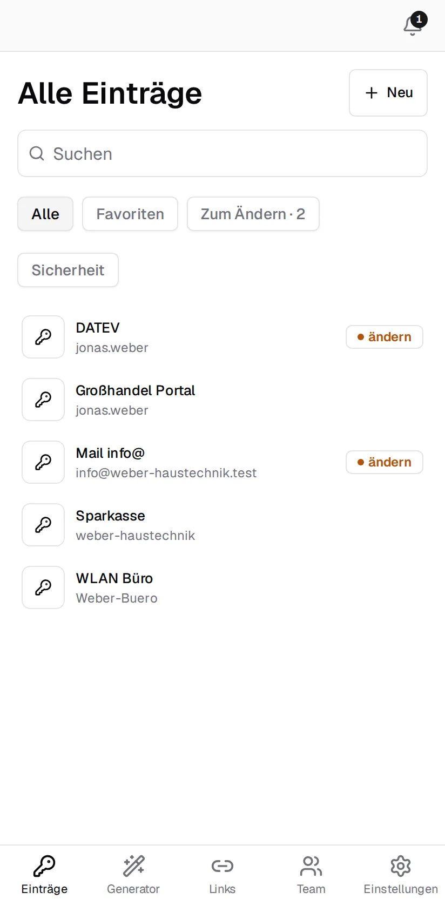

<div align="center">

<h1>Kennwort: der Passwortmanager für dein Team, selbst gehostet</h1>

**Gemeinsame Zugänge für kleine Betriebe – Ende-zu-Ende-verschlüsselt, auf deinem eigenen Server.**<br>
Bank, Lieferantenportale, WLAN und Kundengeräte an einem Ort, im Browser, als Extension und am Handy.<br>
Open Source, ohne Kosten pro Benutzer, sicher auch dann, wenn der Server selbst angegriffen wird.


[](LICENSE)
[](https://kennwort.app/)

[Warum?](#warum-kennwort) •
[Funktionen](#funktionen) •
[Sicherheit](#sicherheit) •
[Alternativen](#kennwort-und-die-alternativen) •
[FAQ](#faq) •
[Demo](https://kennwort.app/demo/) •
[Dokumentation](https://kennwort.app/)

</div>

> [!WARNING]
> **In Entwicklung:** Kennwort ist noch nicht veröffentlicht und nicht extern geprüft; die App fürs Handy fehlt noch. Bitte noch keine echten Passwörter damit verwalten. Ausprobieren ohne Server: in der [Demo](https://kennwort.app/demo/) mit Testdaten.

<p align="center">
<picture>
  <source media="(prefers-color-scheme: dark)" srcset="docs/assets/screenshots/entry-desktop-dark.webp">
  
</picture>
<picture>
  <source media="(prefers-color-scheme: dark)" srcset="docs/assets/screenshots/entries-phone-dark.webp">
  
</picture>
<picture>
  <source media="(prefers-color-scheme: dark)" srcset="docs/assets/screenshots/popup-extension-dark.webp">
  
</picture>
</p>

## Warum Kennwort?

In vielen Betrieben liegen die gemeinsamen Zugänge in einer Excel-Liste, auf Zetteln oder in einem Abo-Tool, das pro
Kopf kostet. Kennwort ist die Open-Source-Alternative zu Team Password Manager, Bitwarden und Passbolt, die du auf
deinem eigenen Server betreibst.

- **Nur ihr könnt es lesen**: Ende-zu-Ende-verschlüsselt, mit Post-Quanten-Schutz; der Server sieht nur
  Verschlüsseltes und kann niemandem heimlich Zugriff geben.
- **Anmelden mit Passkey**: entsperrt wird mit Passphrase und Secret Key, die dein Gerät nie verlassen; Passkeys für Websites speichert Kennwort gleich mit.
- **Für Teams gebaut**: Tresore, Gruppen, Rechte, Zugriff auf Zeit, Freigabe durch Verwalter, Audit-Log.
- **Für Handwerk und IT-Dienstleister**: QR-Etiketten für Geräte, Übergabe der Zugänge an den Kunden, mehrere
  Firmen in einem Konto.
- **Keine Kosten pro Kopf**: zehn Mitarbeiter kosten so viel wie einer; bezahlt wird nur der Server.

## Funktionen

Ausprobieren ohne Installation: die [Demo](https://kennwort.app/demo/) mit der Beispielfirma „Weber Haustechnik“, ganz im Browser und ohne Server.

| Bereich | Was Kennwort kann |
|---|---|
| 🔑 Konto | Firma mit Einrichtungs-Code anlegen, Mitglieder per Einladungslink einladen und bestätigen, Rollen (Inhaber, Admin, Mitarbeiter), signierte Firmen-Richtlinien (Sperrzeit), Recovery-Kit als PDF, Entsperren mit Passphrase, Passphrase vergessen mit dem Recovery Key, alle Schlüssel erneuern, wenn das Recovery-Kit in fremde Hände geraten ist (neues Kit, Bestätigung per Vergleichscode, neue Tresor-Schlüssel), Firmen-Recovery (Zugang über einen Inhaber wiederherstellen), Notfallzugriff mit Wartezeit für eine Person des Vertrauens (Ansehen ausgewählter Tresore oder Vollzugriff, Widerspruch bis zum Ende der Wartezeit), neues Gerät per QR-Code, Geräteliste und Gerät abmelden, automatisches Sperren, gespeicherte Daten als JSON herunterladen und Konto löschen mit der Passphrase ([Datenschutz](https://kennwort.app/datenschutz.html)) |
| 🔐 Tresore und Einträge | Logins, Notizen, WLAN, Karten, SSH- und API-Schlüssel, Anhänge, TOTP, Passkeys; Generator für Passwörter und Passphrasen; frühere Passwörter, Favoriten, Tags und Suche über alles |
| 👥 Team | Gruppen, Rollen, Zugriff anfragen, Zugriff auf Zeit, einzelnen Eintrag teilen, aus Tresor oder Firma entfernen mit Schlüsselwechsel, „Zum Ändern“ für alles, was die Person lesen konnte, Austritts-Bericht und ein neuer Firmenschlüssel, wenn ein Inhaber oder Admin geht (jedes Mitglied übernimmt ihn erst nach dem Vergleichscode) |
| 🛠️ Handwerk und IT-Dienstleister | QR-Etiketten für Geräte und Anlagen in drei Etikettengrößen (der Code führt nur zum Eintrag, nie zu einem Passwort, und öffnet ihn erst nach dem Entsperren); mehrere Firmen in einem Konto mit Wechsel in den Einstellungen und der Seitenleiste – beitreten per Einladungslink oder neue Firma anlegen, ohne neue Passphrase, jede Firma mit eigenen Schlüsseln und strikt getrennt; Übergabe eines Tresors an die Firma des Kunden, neu verschlüsselt auf dem Gerät, der Kunde wird Verwalter und kann den Handwerker jederzeit entfernen ([Handwerk und IT-Dienstleister](https://kennwort.app/handwerk.html)) |
| 🪪 Anmeldedienst | Optional OpenID Connect mit Keycloak, Authentik, Entra ID oder Kontext: „Mit … anmelden“, neue Personen über einen Link zum Beitreten (bestätigt erst nach Codevergleich), Gruppen folgen dem groups-Claim als Zugriffsanfragen; der Anmeldedienst bekommt nie einen Schlüssel und keine Sitzung für bestehende Konten. Deep Links auf Tresor und Eintrag per ID (`web+kennwort:`) ([Anmeldedienst und Deep Links](https://kennwort.app/anmeldedienst.html)) |
| 🔔 Mitteilungen | Glocke mit Zähler für alles, was auf dich wartet (Zugriffsanfragen, angenommene Einladungen, geteilte Einträge, Notfallzugriff, neuer Firmenschlüssel, abgerufene Einmal-Links), live in der App; auf Wunsch Push aufs Handy oder den Rechner, je Art wählbar – der Push sagt nur „Neue Mitteilung in Kennwort“, Server und Push-Dienste sehen keine Namen ([Mitteilungen](https://kennwort.app/mitteilungen.html)) |
| 🧩 Browser-Extension | Chrome und Edge, Firefox ab 140 (auch Android ab 142) und Safari ab 18 auf Mac, iPhone und iPad; in Firefox und Safari zeigt das Inline-Menü die Treffer, füllt, speichert und signiert aber nicht, weil diese Browser nicht bestätigen können, dass das Menü sichtbar ist (Schutz vor Clickjacking) – dort kopierst du aus dem Popup; Popup zum Entsperren mit Treffern für die Seite (exakter Host), Suche, Favoriten, Kopieren und Generator; Inline-Menü unter Login-Feldern, das erst nach Klick oder Enter ausfüllt, nur auf dem exakten Host, nie in fremde iFrames und nicht, wenn eine Seite das Menü verdeckt; bietet nach dem Anmelden an, ein neues Login zu speichern oder ein geändertes Passwort zu aktualisieren (das alte bleibt unter „Frühere Passwörter“), mit „Nie für diese Seite“; Phishing-Warnung, wenn du ein gespeichertes Passwort auf einer anderen Seite eintippst als der, für die es gespeichert ist – ohne dass das Passwort die Seite im Klartext verlässt; Passkey-Anbieter: Passkeys für Websites in Kennwort speichern und damit anmelden, erst nach deinem Klick, mit „Anderes Gerät verwenden“ für das WebAuthn des Browsers |
| ⌨️ Kommandozeile | `kennwort` für Terminal und Skripte: Rechner mit dem Konto verbinden, Einträge nach Titel, Benutzername und Adresse suchen, Passwort, Benutzername oder Einmal-Code erst nach Bestätigung ausgeben (für Skripte mit `--yes`); entsperrt je Befehl, nichts bleibt entsperrt, geprüft wie in der Web-App ([Kommandozeile](https://kennwort.app/cli.html)) |
| 📱 Handy | Web-App zum Installieren (PWA), die nur signierte und geprüfte Updates annimmt und ohne Verbindung entsperrt und liest; die App für Android (im Bau, noch ohne Release) füllt in anderen Apps und Browsern über den Autofill-Dienst aus, erst nach Tippen, Entsperren und Wahl eines Eintrags für genau diese App oder Website; iOS folgt ([Handy und App](https://kennwort.app/handy.html)) |
| 🔁 Umzug | Import aus Bitwarden (auch der passwortgeschützte Export), LastPass, 1Password, KeePass (auch die KDBX-Datenbank mit Master-Passwort und Schlüsseldatei), Team Password Manager (Projekte als Ordner), Passbolt, jedem Manager mit FIDO Credential Exchange (CXF, auch Passkeys), den Browsern, jeder Tabelle und Authenticator-Apps (Google Authenticator per QR-Code, Aegis, 2FAS; die Codes auf Wunsch in den passenden vorhandenen Login, ohne einen anderen Code zu überschreiben): Anbieter wählen, Anleitung, Vorschau ohne Geheimnisse, Duplikate überspringen, schwache Passwörter gleich unter „Zum Ändern“ |
| 📤 Export | Inhaber und Admins exportieren einen Tresor oder alle als verschlüsseltes JSON (wieder importierbar, mit allem), als KeePass-Datenbank (KDBX 4) oder als CSV für andere Passwortmanager; die Datei entsteht nur auf dem Gerät, jeder Export steht im Audit-Log |
| 🛡️ Sicherheit im Alltag | [Sicherheits-Übersicht](https://kennwort.app/sicherheit.html) mit schwachen, mehrfach verwendeten und geleakten Passwörtern und „Jetzt ändern“ direkt zur Seite der Website fürs Passwortändern (`/.well-known/change-password`); Prüfung gegen Datenlecks nur auf Wunsch, je Person, per k-Anonymität (nur 5 Zeichen eines Hashs gehen über deinen Server hinaus, das Passwort nie); Monatsbericht für Inhaber und Admins; „Zum Ändern“-Liste, Einmal-Links für Externe ohne Konto (ein Eintrag oder freier Text, bis zu sieben Tage und zehn Abrufe, auf Wunsch mit Passphrase, jederzeit widerrufbar; erst ein Klick zeigt den Inhalt, damit Linkvorschauen ihn nicht verbrauchen) |

## Installation

Ein Container mit Caddy davor für TLS, mit Docker Compose oder Podman Quadlet:

```sh
curl -fsSLO https://raw.githubusercontent.com/Speicherstadt/kennwort/main/docker/compose.yaml
curl -fsSLO https://raw.githubusercontent.com/Speicherstadt/kennwort/main/docker/Caddyfile
curl -fsSL -o .env https://raw.githubusercontent.com/Speicherstadt/kennwort/main/docker/kennwort.env.example
# KENNWORT_DOMAIN, KENNWORT_AUTH_SECRET und KENNWORT_SETUP_CODE in .env eintragen
docker compose up -d
```

Das Image `ghcr.io/speicherstadt/kennwort` (amd64, arm64) läuft ohne root und ohne Shell, schreibt
nur in sein Volume und trägt dieselbe signierte Web-App wie das Release. Backups macht der Server
selbst, während er läuft (`kennwort-server backup`); sie enthalten nur Chiffretext, nie einen
Schlüssel. Erscheint ein neues Release, erfahren es Inhaber und Admins in der App (abschaltbar).
Mehr: [Installation](https://kennwort.app/installation.html), [Verwaltung](https://kennwort.app/verwaltung.html),
[Backups](https://kennwort.app/backup.html), [Updates](https://kennwort.app/updates.html).

## Sicherheit

Kennwort verschlüsselt auf deinem Gerät, bevor etwas den Server erreicht: XChaCha20-Poly1305, X25519 kombiniert
mit ML-KEM-768 (Post-Quanten-Schutz), Ed25519-Signaturen und Argon2id. Jede Mitgliedschaft in einem Tresor ist
signiert, jeder Geheimtext an seinen Eintrag gebunden; so kann auch ein gehackter Server niemandem Zugriff
verschaffen; alle 27 Angriffe der ETH-Studie zu Passwortmanagern mit bösartigem Server laufen als Tests. Die Details stehen im [Sicherheitsdesign](https://kennwort.app/sicherheitsdesign.html); Lücken bitte
privat melden, siehe [SECURITY.md](SECURITY.md).

## Kennwort und die Alternativen

| | Was es ist | Wo Kennwort anders ist |
|---|---|---|
| [Bitwarden](https://bitwarden.com/) | verbreiteter Open-Source-Passwortmanager | für kleine Teams einfacher, Post-Quanten-Schutz, gegen einen bösartigen Server gebaut |
| [Passbolt](https://www.passbolt.com/) | Team-Passwortmanager mit Extension, PHP | ein Container mit Bun und SQLite, moderne Kryptografie statt OpenPGP, alles ohne Pro-Version |
| [Team Password Manager](https://teampasswordmanager.com/) | Team-Passwortmanager zum Selbsthosten | Open Source, Ende-zu-Ende-verschlüsselt, mit Extension und App |

## FAQ

### Gibt es einen selbst gehosteten Passwortmanager für kleine Firmen?
Ja, dafür ist Kennwort gemacht: ein Container auf deinem Server, Tresore und Gruppen fürs Team, ohne Kosten pro Benutzer.

### Kann ich von Bitwarden, LastPass oder 1Password umziehen?
Ja. Kennwort liest deren Exporte direkt auf deinem Gerät; die Datei wird nie hochgeladen.

### Brauche ich einen Anmeldedienst wie Keycloak?
Nein. Kennwort hat eigene Konten mit Anmeldung per Passkey; OpenID Connect ist ein Zusatz für Firmen, die schon einen haben. Auch dann entsperrst du mit deiner Passphrase: Der Anmeldedienst bestätigt nur, wer du bist, und bekommt nie einen Schlüssel.

Weitere Antworten in der [FAQ](https://kennwort.app/faq.html).

## Entwicklung

Bun, Hono, Drizzle und SQLite auf dem Server; Solid, Tailwind und die `@noble`-Bibliotheken im Client; Tauri für die
App. Hinweise für Mitwirkende und Agenten stehen in [CLAUDE.md](CLAUDE.md).

---

<div align="center">

<sub>Lizenz: <a href="LICENSE">AGPL-3.0</a> · © Tristan Teufel und Mitwirkende<br>
Veränderte Versionen, die du weitergibst oder für andere betreibst, müssen ihren Quellcode unter der AGPL anbieten; eine kommerzielle Lizenz ohne diese Pflichten gibt es über <a href="https://teufel-it.de">teufel-it.de</a>.<br>
Kennwort steht in keiner Verbindung zu Bitwarden, Passbolt, Team Password Manager oder den anderen genannten Produkten.</sub>

</div>
