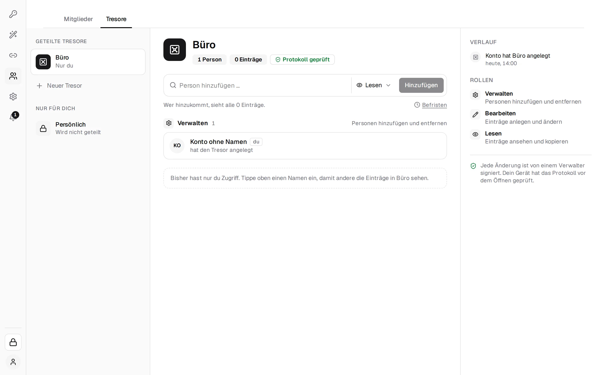
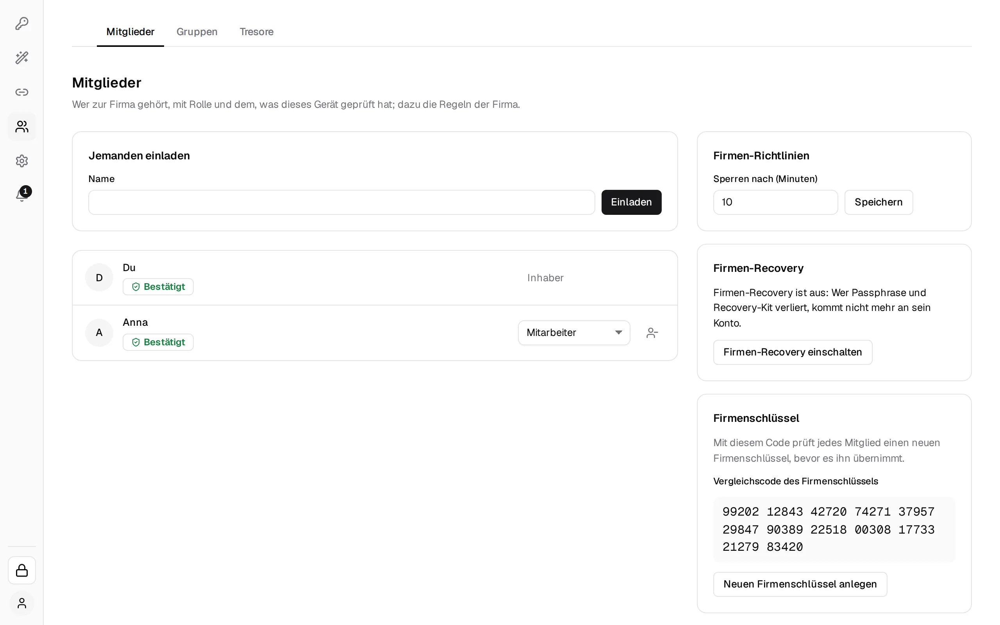
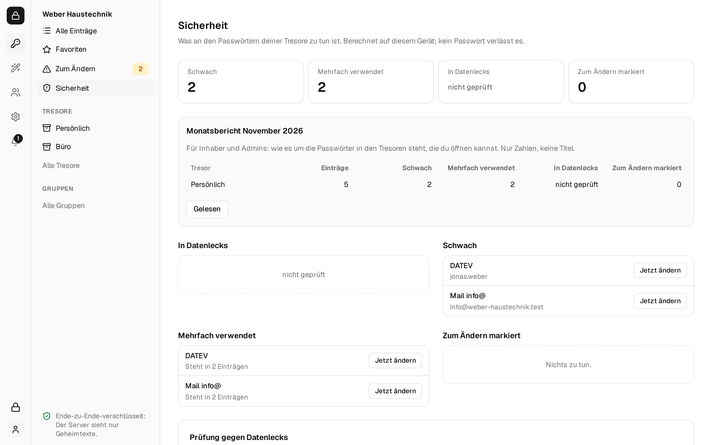
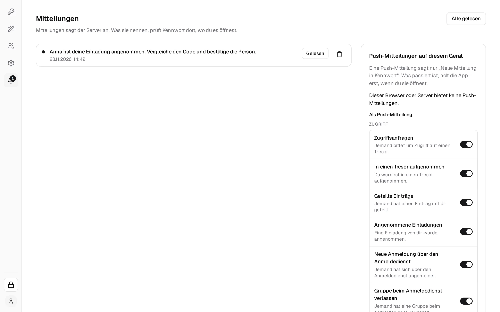
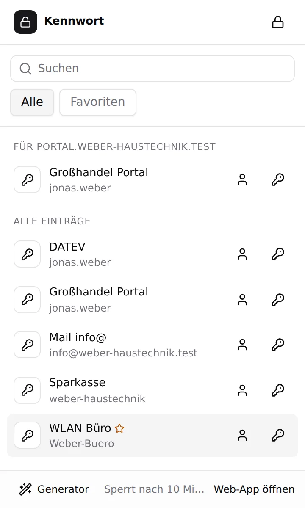

<div align="center">

<h1>Kennwort: Die Zugänge deines Teams, nur für euch lesbar.</h1>

<picture>
  <source media="(prefers-color-scheme: dark)" srcset="docs/assets/screenshots/entry-desktop-dark.webp">
  
</picture>

**Der Passwortmanager für kleine Betriebe, selbst gehostet und Ende-zu-Ende-verschlüsselt.**

Bank, Lieferantenportale, WLAN und Kundengeräte an einem Ort: im Browser, als Extension, am Handy und im Terminal.
Open Source, ohne Kosten pro Benutzer, mit Post-Quanten-Schutz und sicher auch dann, wenn der Server selbst angegriffen wird.


[](https://github.com/Speicherstadt/kennwort/actions/workflows/ci.yml)
[](LICENSE)
[](https://kennwort.app/)
[-1f6f5c)](https://kennwort.app/kryptografie.html)
[](https://kennwort.app/sicherheitsdesign.html#angriffe-als-tests)
[](https://kennwort.app/kryptografie.html#wenige-geprufte-bausteine-und-strenge-tests)

[Warum?](#warum-kennwort) •
[Funktionen](#funktionen) •
[Kryptografie](#kryptografie) •
[Installation](#installation) •
[FAQ](#faq) •
[Demo](https://kennwort.app/demo/) •
[Dokumentation](https://kennwort.app/) •
[Entwicklung](#entwicklung)

<sub>English: a self-hosted, end-to-end encrypted password manager for small business teams, with post-quantum key wrapping (X-Wing), a client that verifies everything a malicious server sends, a browser extension, a CLI and an Android app. The app is in German and English; its [documentation](https://kennwort.app/) is in German.</sub>

</div>

> [!WARNING]
> **In Entwicklung:** Kennwort ist noch nicht veröffentlicht und nicht extern geprüft; die App für Android ist eine
> Alpha ohne Release, die iOS-App fehlt noch. Bitte noch keine echten Passwörter damit verwalten. Ausprobieren ohne
> Server: in der [Demo](https://kennwort.app/demo/) mit Testdaten.

## Warum Kennwort?

**Eure Passwörter gehören auf euren Server, nicht in eine Excel-Liste.** 🇩🇪 🇪🇺

In vielen Betrieben liegen die gemeinsamen Zugänge in einer Tabelle, auf Zetteln oder in einem Abo-Tool, das pro
Kopf kostet. Kennwort ist die Open-Source-Alternative zu Team Password Manager, Bitwarden und Passbolt, die du auf
deinem eigenen Server betreibst.

**Für wen?** Handwerksbetriebe, Praxen, Kanzleien, Agenturen und IT-Dienstleister mit ein paar bis ein paar
Dutzend Leuten. Du brauchst einen Server oder ein NAS mit Docker oder Podman und eine Domain.

- **Nur ihr könnt es lesen**: Ende-zu-Ende-verschlüsselt, mit Post-Quanten-Schutz; der Server sieht nur
  Verschlüsseltes und kann niemandem heimlich Zugriff geben, siehe [Kryptografie](#kryptografie).
- **Entsperren mit Passkey**: in der Web-App mit einem Passkey (WebAuthn PRF) statt der Passphrase, die daneben
  weiter funktioniert; der Server sieht nur den mit dem Passkey verschlüsselten Kontoschlüssel. Passkeys für
  Websites speichert Kennwort gleich mit.
- **Für Teams gebaut**: Tresore, Gruppen, Rechte, Zugriff auf Zeit, Freigabe durch Verwalter, Audit-Log.
- **Für Handwerk und IT-Dienstleister**: QR-Etiketten für Geräte, Übergabe der Zugänge an den Kunden, mehrere
  Firmen in einem Konto.
- **Keine Kosten pro Kopf**: zehn Mitarbeiter kosten so viel wie einer; bezahlt wird nur der Server.

## Funktionen

Kurz je Bereich; die Details stehen auf der verlinkten Seite der [Dokumentation](https://kennwort.app/).
Ausprobieren ohne Installation: die [Demo](https://kennwort.app/demo/) mit der Beispielfirma „Weber Haustechnik“,
ganz im Browser und ohne Server.

| Bereich | Was Kennwort kann |
|---|---|
| 🔑 [Konto und Entsperren](https://kennwort.app/konto.html) | Firma mit Einrichtungs-Code anlegen, Mitglieder per Einladungslink einladen und per Vergleichscode bestätigen, Rollen (Inhaber, Admin, Mitarbeiter), signierte Firmen-Richtlinien; entsperren mit Passphrase und Secret Key oder mit Passkey; Recovery-Kit als PDF, Firmen-Recovery über einen Inhaber, Notfallzugriff mit Wartezeit, alle Schlüssel erneuern, wenn das Kit in fremde Hände geraten ist; neues Gerät per QR-Code, Geräteliste, automatisches Sperren, ohne Verbindung lesen |
| 🔐 [Tresore](https://kennwort.app/tresore.html) · [Einträge](https://kennwort.app/eintraege.html) | Logins, Notizen, WLAN, Karten, SSH- und API-Schlüssel, Anhänge, TOTP, Passkeys; Generator für Passwörter und Passphrasen; frühere Passwörter, Favoriten, Tags und Suche über alles; Live-Sync zwischen allen Geräten |
| 👥 Team | Gruppen, Rollen, Zugriff anfragen, Zugriff auf Zeit, einzelnen Eintrag teilen, aus Tresor oder Firma entfernen mit Schlüsselwechsel, „Zum Ändern“ für alles, was die Person lesen konnte, und ein neuer Firmenschlüssel, wenn ein Inhaber oder Admin geht |
| 🛠️ [Handwerk und IT-Dienstleister](https://kennwort.app/handwerk.html) | QR-Etiketten für Geräte und Anlagen (der Code führt nur zum Eintrag, nie zu einem Passwort), mehrere Firmen in einem Konto, strikt getrennt; Übergabe eines Tresors an die Firma des Kunden, neu verschlüsselt auf dem Gerät |
| 🪪 [Anmeldedienst und Deep Links](https://kennwort.app/anmeldedienst.html) | Optional OpenID Connect mit Keycloak, Authentik, Entra ID oder Kontext; Gruppen folgen dem groups-Claim als Zugriffsanfragen; der Anmeldedienst bekommt nie einen Schlüssel. Deep Links auf Tresor und Eintrag (`web+kennwort:`) |
| 🔔 [Mitteilungen](https://kennwort.app/mitteilungen.html) | Glocke für alles, was auf dich wartet, live in der App; auf Wunsch Push, der nur „Neue Mitteilung in Kennwort“ sagt |
| 🔗 [Einmal-Links](https://kennwort.app/einmal-links.html) | Ein Eintrag oder freier Text für Externe ohne Konto, bis zu sieben Tage und zehn Abrufe, auf Wunsch mit Passphrase, jederzeit widerrufbar |
| 🧩 [Browser-Extension](https://kennwort.app/extension.html) | Chrome und Edge, Firefox ab 140 (auch Android), Safari ab 18; Popup mit Treffern für den exakten Host, Inline-Menü, das erst nach Klick ausfüllt und nie in fremde iFrames; neue Logins speichern, Phishing-Warnung, Passkey-Anbieter für Websites |
| ⌨️ [Kommandozeile](https://kennwort.app/cli.html) | `kennwort` für Terminal und Skripte: suchen, Passwort oder Einmal-Code erst nach Bestätigung ausgeben; entsperrt je Befehl, nichts bleibt entsperrt |
| 📱 [Handy und App](https://kennwort.app/handy.html) | Web-App zum Installieren (PWA), die nur signierte Updates annimmt und offline entsperrt; App für Android (Alpha, noch ohne Release) mit eigenem Server, Live-Sync und Autofill-Dienst, der erst nach Tippen, Entsperren und Wahl eines Eintrags ausfüllt; iOS folgt |
| 🔁 [Import und Export](https://kennwort.app/import-export.html) | Import aus Bitwarden (auch passwortgeschützt), LastPass, 1Password, KeePass (KDBX), Team Password Manager, Passbolt, FIDO CXF (auch Passkeys), den Browsern, Tabellen und Authenticator-Apps, alles auf dem Gerät; Export als verschlüsseltes JSON, KDBX 4 oder CSV, im Audit-Log |
| 🛡️ [Sicherheits-Übersicht](https://kennwort.app/sicherheit.html) | Schwache, mehrfach verwendete und geleakte Passwörter mit „Jetzt ändern“; Prüfung gegen Datenlecks nur auf Wunsch, per k-Anonymität; Monatsbericht für Inhaber und Admins |
| 🗂️ [Datenschutz](https://kennwort.app/datenschutz.html) | Was der Server sieht, gespeicherte Daten als JSON herunterladen, Konto löschen mit der Passphrase |

## Screenshots

<table>
  <tr>
    <td width="50%"><picture><source media="(prefers-color-scheme: dark)" srcset="docs/assets/screenshots/vaults-desktop-dark.webp"></picture><br><sub><b>Tresore</b>: wer was sehen und ändern darf</sub></td>
    <td width="50%"><picture><source media="(prefers-color-scheme: dark)" srcset="docs/assets/screenshots/members-desktop-dark.webp"></picture><br><sub><b>Mitglieder</b>: einladen, per Code bestätigen, Rollen</sub></td>
  </tr>
  <tr>
    <td width="50%"><picture><source media="(prefers-color-scheme: dark)" srcset="docs/assets/screenshots/security-desktop-dark.webp"></picture><br><sub><b>Sicherheits-Übersicht</b>: was geändert werden sollte</sub></td>
    <td width="50%"><picture><source media="(prefers-color-scheme: dark)" srcset="docs/assets/screenshots/notifications-desktop-dark.webp"></picture><br><sub><b>Mitteilungen</b>: Anfragen und Freigaben, live</sub></td>
  </tr>
  <tr>
    <td width="50%" align="center"><picture><source media="(prefers-color-scheme: dark)" srcset="docs/assets/screenshots/entries-phone-dark.webp"></picture><br><sub><b>Am Handy</b>: ein Bildschirm nach dem anderen</sub></td>
    <td width="50%" align="center"><picture><source media="(prefers-color-scheme: dark)" srcset="docs/assets/screenshots/popup-extension-dark.webp"></picture><br><sub><b>Extension</b>: Treffer nur für den exakten Host</sub></td>
  </tr>
</table>

## Kryptografie

**Gebaut für den Fall, dass der Server selbst angreift.** Kennwort verschlüsselt auf deinem Gerät, und dein Gerät
prüft alles, was der Server schickt. Die Studie der ETH Zürich zu Passwortmanagern mit bösartigem Server
(USENIX Security 2026) zeigte, dass das bei verbreiteten Produkten nicht selbstverständlich ist.

- 🛰️ **Post-Quanten-Schutz**: Tresor-Schlüssel werden mit X-Wing verpackt, X25519 und ML-KEM-768 (FIPS 203)
  zusammen. Wer heute Daten stiehlt, um sie mit einem künftigen Quantenrechner zu öffnen, hat nichts davon.
- 🔒 **XChaCha20-Poly1305 mit AAD**: Jeder Geheimtext ist an Tresor, Eintrag und Version gebunden; alle Felder eines
  Eintrags liegen in einem Geheimtext. Der Server kann nichts vertauschen, verschieben oder umbiegen.
- 🧂 **Argon2id plus Secret Key**: 128 zufällige Bit, die nie auf den Server gehen, wie 1Passwords Secret Key. Eine
  gestohlene Datenbank lässt sich auch bei schwacher Passphrase nicht raten; die Parameter kann der Server nicht senken.
- ✍️ **Signierte Mitgliedschaften**: Wer in einem Tresor ist, steht in einer Hash-Kette mit Ed25519-Unterschriften;
  öffentliche Schlüssel kommen nur aus Zertifikaten der Firma. Der Server kann niemanden und keinen Schlüssel unterschieben.
- ⏪ **Kein Zurückspielen**: Ältere Stände von Einträgen, Logs und der Web-App selbst lehnt das Gerät ab.
- 🧪 **27 Angriffe als Tests**, nur geprüfte `@noble`-Bibliotheken ohne eigene Primitive, unabhängige
  Testvektoren, Property-Tests und Mutation-Tests mit 100 %.
- 📦 **Signierte, reproduzierbare Web-App**: Der Service Worker nimmt ein Update nur mit gültiger Signatur und
  passenden Hashes; jeder kann den Build Byte für Byte nachbauen.
- 🔑 **Entsperren mit Passkey** über die PRF-Erweiterung von WebAuthn; der Server sieht den PRF-Wert nie.

Ehrlich dazu: Ein externes Audit gibt es noch nicht, `@noble/post-quantum` ist anders als die übrigen
`@noble`-Bibliotheken noch nicht unabhängig geprüft (darum nur zusammen mit X25519), und Signaturen sind nicht
quantensicher. Alles im Detail, mit dem Vergleich zu Bitwarden, 1Password und Passbolt und allen Grenzen:
**[Kryptografie](https://kennwort.app/kryptografie.html)**; die Formate und Protokolle im
[Sicherheitsdesign](https://kennwort.app/sicherheitsdesign.html). Lücken bitte privat melden, siehe
[SECURITY.md](SECURITY.md).

## Kennwort und die Alternativen

| | Was es ist | Wo Kennwort anders ist |
|---|---|---|
| [Bitwarden](https://bitwarden.com/) | verbreiteter Open-Source-Passwortmanager, extern geprüft | für kleine Teams einfacher, Post-Quanten-Schutz beim Teilen, gegen einen bösartigen Server gebaut; dafür noch ohne Audit |
| [1Password](https://1password.com/) | Passwortmanager als Cloud-Dienst mit Secret Key | Open Source und selbst gehostet; den Secret Key gibt es bei beiden |
| [Passbolt](https://www.passbolt.com/) | Team-Passwortmanager mit Extension, PHP und OpenPGP | ein Container mit Bun und SQLite, wenige moderne Verfahren statt OpenPGP, alles ohne Pro-Version |
| [Team Password Manager](https://teampasswordmanager.com/) | Team-Passwortmanager zum Selbsthosten | Open Source, Ende-zu-Ende-verschlüsselt, mit Extension und App |

Umziehen geht aus allen vier direkt auf deinem Gerät, siehe [Import und Export](https://kennwort.app/import-export.html).

## Installation

Ein Container mit Caddy davor für TLS, mit Docker Compose oder Podman Quadlet. Du brauchst einen Linux-Server oder
ein NAS und eine Domain, die auf ihn zeigt, denn Passkeys und die Extension brauchen HTTPS.

```sh
curl -fsSLO https://raw.githubusercontent.com/Speicherstadt/kennwort/main/docker/compose.yaml
curl -fsSLO https://raw.githubusercontent.com/Speicherstadt/kennwort/main/docker/Caddyfile
curl -fsSL -o .env https://raw.githubusercontent.com/Speicherstadt/kennwort/main/docker/kennwort.env.example
# KENNWORT_DOMAIN, KENNWORT_AUTH_SECRET und KENNWORT_SETUP_CODE in .env eintragen
docker compose up -d
```

Öffne **https://deine-domain**, leg mit dem Einrichtungs-Code deine Firma an und druck das Recovery-Kit aus.

Das Image `ghcr.io/speicherstadt/kennwort` (amd64, arm64) läuft ohne root und ohne Shell, schreibt nur in sein
Volume und trägt dieselbe signierte Web-App wie das Release. Mehr: [Installation](https://kennwort.app/installation.html),
[Verwaltung](https://kennwort.app/verwaltung.html), [Backups](https://kennwort.app/backup.html),
[Updates](https://kennwort.app/updates.html).

> [!IMPORTANT]
> Backups macht der Server selbst, während er läuft (`kennwort-server backup`); sie enthalten nur Chiffretext, nie
> einen Schlüssel. Ohne Passphrase und Secret Key, das Recovery-Kit oder die Firmen-Recovery kann niemand ein Konto
> öffnen, auch der Betreiber nicht. Bewahrt die Recovery-Kits gut auf.

## FAQ

<details>
<summary><b>Was kostet Kennwort?</b></summary>

Nichts pro Benutzer. Kennwort ist Open Source (AGPL-3.0); du bezahlst nur den Server, auf dem es läuft.
</details>

<details>
<summary><b>Was passiert, wenn der Server gehackt wird?</b></summary>

Der Server speichert nur Verschlüsseltes und öffentliche Schlüssel. Jede Mitgliedschaft ist unterschrieben und
jeder Geheimtext an seinen Eintrag gebunden; dein Gerät prüft beides. So kann auch ein gehackter Server weder
mitlesen noch jemandem Zugriff geben. Was er trotzdem kann (etwa einen neuen Eintrag verschweigen), steht unter
[Grenzen](https://kennwort.app/kryptografie.html#grenzen).
</details>

<details>
<summary><b>Kann ich von Bitwarden, LastPass oder 1Password umziehen?</b></summary>

Ja, auch von KeePass, Team Password Manager, Passbolt und den Browsern. Kennwort liest die Exporte direkt auf
deinem Gerät; die Datei wird nie hochgeladen ([Import und Export](https://kennwort.app/import-export.html)).
</details>

<details>
<summary><b>Ich habe meine Passphrase vergessen.</b></summary>

Mit dem Recovery-Kit setzt du eine neue. Hat deine Firma die Firmen-Recovery eingeschaltet, hilft auch ein Inhaber.
Sonst kann sie niemand zurücksetzen, auch der Betreiber nicht ([Konto und Entsperren](https://kennwort.app/konto.html)).
</details>

<details>
<summary><b>Brauche ich einen Anmeldedienst wie Keycloak?</b></summary>

Nein. Kennwort hat eigene Konten mit Anmeldung per Passkey; OpenID Connect ist ein Zusatz für Firmen, die schon
einen haben. Auch dann entsperrst du selbst: Der Anmeldedienst bestätigt nur, wer du bist, und bekommt nie einen
Schlüssel ([Anmeldedienst](https://kennwort.app/anmeldedienst.html)).
</details>

<details>
<summary><b>Gibt es eine App fürs Handy?</b></summary>

Die Web-App lässt sich heute schon installieren und entsperrt auch offline. Die App für Android verbindet sich mit
deinem Server, synchronisiert live und füllt in anderen Apps aus, ist aber eine Alpha ohne Release; die iOS-App
fehlt noch ([Handy und App](https://kennwort.app/handy.html)).
</details>

<details>
<summary><b>Ist das sicher?</b></summary>

Gebaut und geprüft ist es dafür, ein externes Audit gibt es aber noch nicht; es steht vor der Veröffentlichung an.

- **Geprüft durch Tests:** alle 27 Angriffe des Katalogs nach der ETH-Studie gegen einen Testserver, der
  absichtlich lügt; Testvektoren, Property-Tests und Mutation-Tests mit 100 % für die Kryptografie.
- **Wenige Abhängigkeiten:** etwa sechs Laufzeitpakete im Client, jedes auf einer Liste mit Begründung, exakt
  gepinnt, ohne Install-Skripte.
- **Offen für alle:** Jeder kann den Code lesen und Lücken melden, bitte vertraulich wie in [SECURITY.md](SECURITY.md)
  beschrieben.
</details>

<details>
<summary><b>Wird Kennwort mit KI entwickelt?</b></summary>

Ja, mit Coding-Agenten, nach einer festen Bauliste: jede Änderung mit Tests zuerst, und jede Änderung an
sicherheitsrelevantem Code erst nach einem unabhängigen Review durch einen zweiten Agenten, der nur meldet, was
ein fehlschlagender Test belegt. Ein externes Audit ersetzt das nicht.
</details>

Weitere Antworten in der [FAQ](https://kennwort.app/faq.html).

## Dokumentation

Alles im Detail, mit Suche: **https://kennwort.app/**. Jede Funktion oben verlinkt ihre Seite; dazu kommen:

- **Einstieg:** [Installation](https://kennwort.app/installation.html), [Konto und Entsperren](https://kennwort.app/konto.html)
  und [Import und Export](https://kennwort.app/import-export.html)
- **Hintergrund:** [Kryptografie](https://kennwort.app/kryptografie.html),
  [Sicherheitsdesign](https://kennwort.app/sicherheitsdesign.html), [Datenschutz](https://kennwort.app/datenschutz.html),
  [Lasttest](https://kennwort.app/lasttest.html) und der [Projektplan](https://kennwort.app/plan.html)

## Entwicklung

[](https://www.typescriptlang.org)
[](https://bun.sh)
[](https://www.solidjs.com)
[](https://hono.dev)
[](https://orm.drizzle.team)
[](https://tauri.app)

Voraussetzungen: Bun in der Version aus `packageManager` in `package.json` und Git.

```sh
bun install
bun run check     # Typen, Lint, Tests und Build
bun run e2e       # Playwright am Rechner und am Handy
```

Hinweise für Mitwirkende und Agenten stehen in [CLAUDE.md](CLAUDE.md), was als Nächstes gebaut wird in
[BAULISTE.md](BAULISTE.md).

| Paket | Inhalt |
|---|---|
| `packages/crypto` | Verfahren, Formate und Schlüsselhierarchie, nur mit `@noble/*`; Testvektoren |
| `packages/core` | Zod-Schemas, Sync, Mitgliedschafts-Log, Import-Parser, der bösartige Testserver |
| `packages/client` | Entsperren, Einträge und Autofill-Abgleich, gemeinsam für Web-App, Extension, App und CLI |
| `packages/ui` | Oberfläche in Solid 2 und Tailwind für Web-App und Extension |
| `apps/server` | Bun, Hono, Drizzle auf SQLite, Better Auth; speichert nur Geheimtexte |
| `apps/web` | Web-App und PWA mit signiertem Service Worker |
| `apps/extension` | Browser-Extension (MV3) für Chrome, Edge, Firefox und Safari |
| `apps/mobile` | App mit Tauri 3 und dem Android-Autofill-Dienst |
| `apps/cli` | Kommandozeile `kennwort` |

## Mehr von uns

Kennwort gehört zur Speicherstadt: Open-Source-Apps für deinen eigenen Server, etwa
[Haben](https://github.com/Speicherstadt/haben) für die Buchhaltung. Mehr auf **[speicherstadt.app](https://speicherstadt.app)**.

## Mitwirken

Fehler und Ideen gern als Issue; Sicherheitslücken bitte vertraulich nach [SECURITY.md](SECURITY.md). Was vor
einem Pull Request laufen muss, steht in [CLAUDE.md](CLAUDE.md) unter „Checks“.

---

<div align="center">

⭐ **Gefällt dir Kennwort?** Ein [Stern auf GitHub](https://github.com/Speicherstadt/kennwort) hilft anderen, es zu finden.

[Fehler melden](https://github.com/Speicherstadt/kennwort/issues/new) &nbsp;·&nbsp; [Demo](https://kennwort.app/demo/) &nbsp;·&nbsp; [Dokumentation](https://kennwort.app/)

<sub>Lizenz: <a href="LICENSE">AGPL-3.0</a> · © Tristan Teufel und Mitwirkende<br>
Veränderte Versionen, die du weitergibst oder für andere betreibst, müssen ihren Quellcode unter der AGPL anbieten; eine kommerzielle Lizenz ohne diese Pflichten gibt es über <a href="https://teufel-it.de">teufel-it.de</a>.<br>
Bitwarden, 1Password, Passbolt, Team Password Manager und die anderen genannten Produkte sind Marken ihrer Inhaber. Kennwort steht mit diesen Unternehmen in keiner Verbindung.</sub>

</div>
