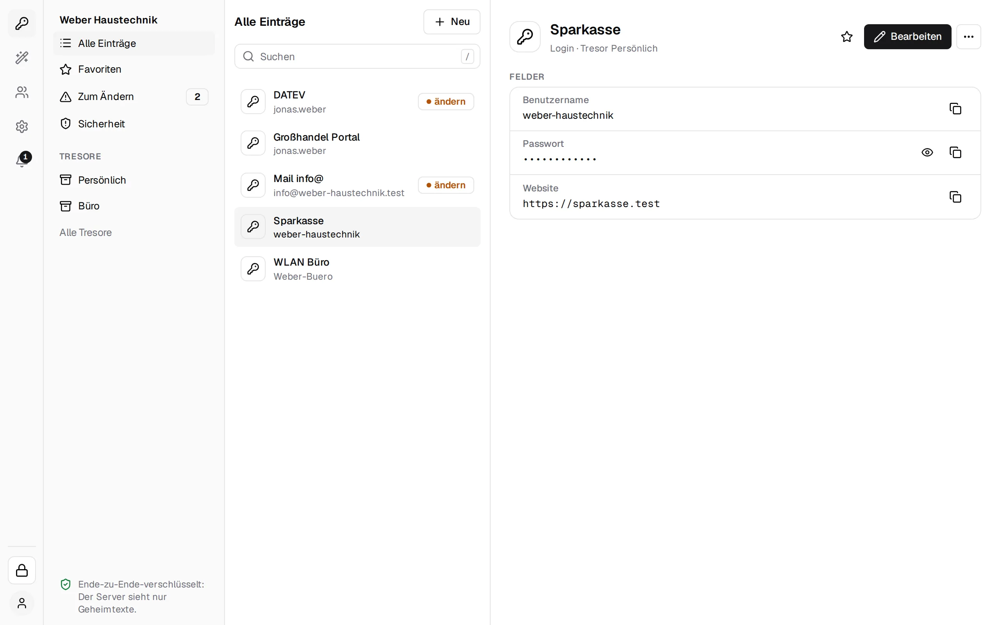
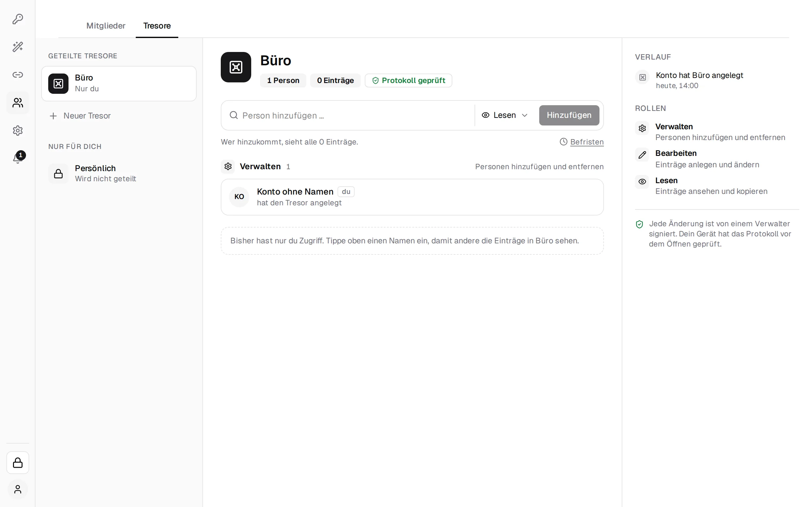
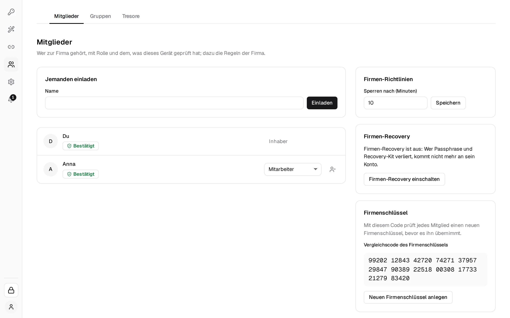
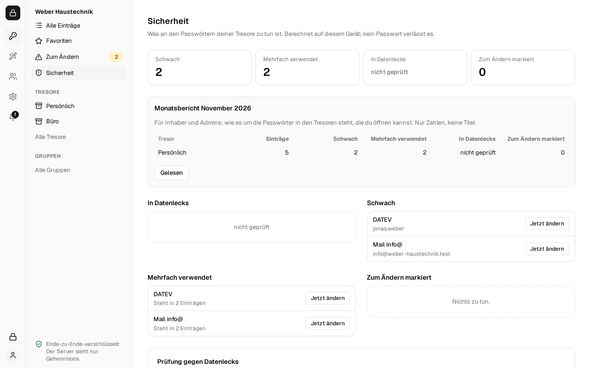
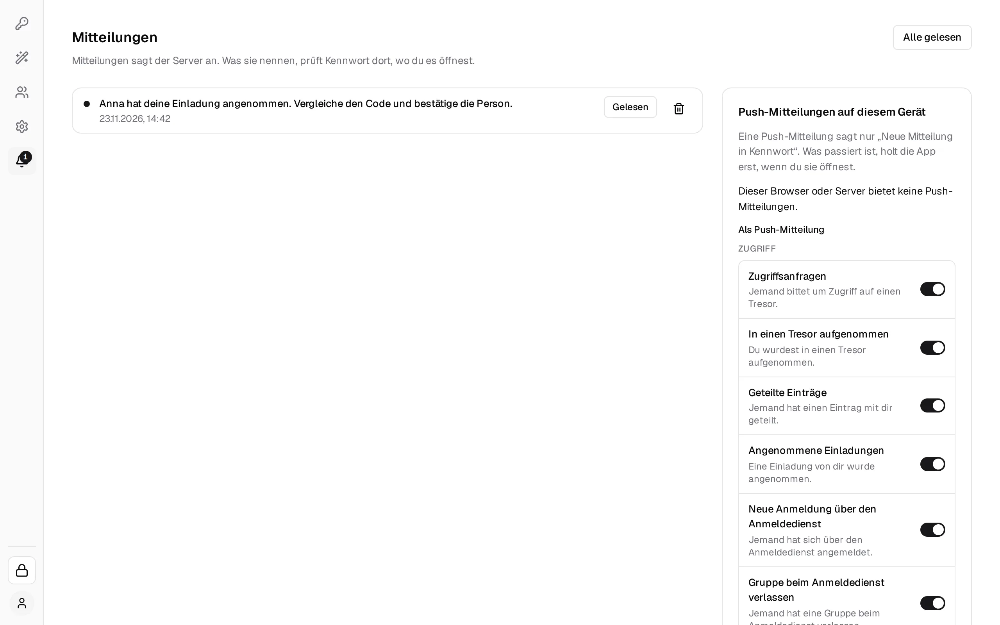
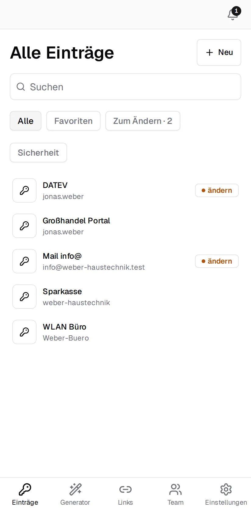
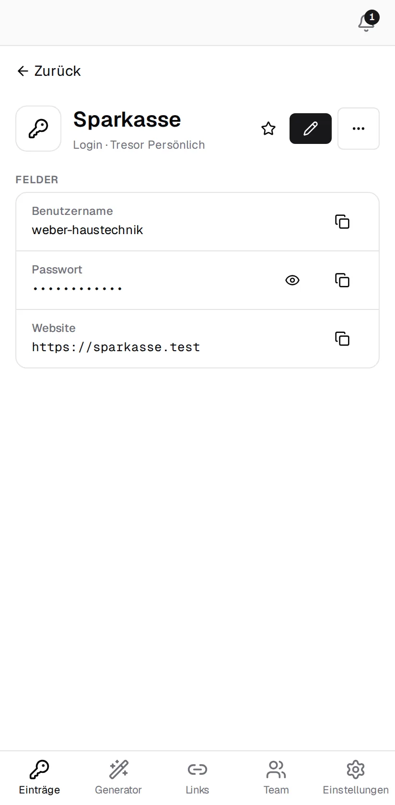
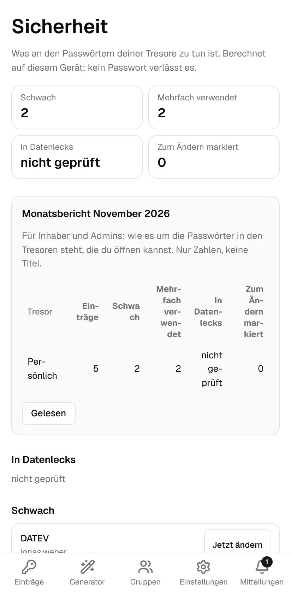
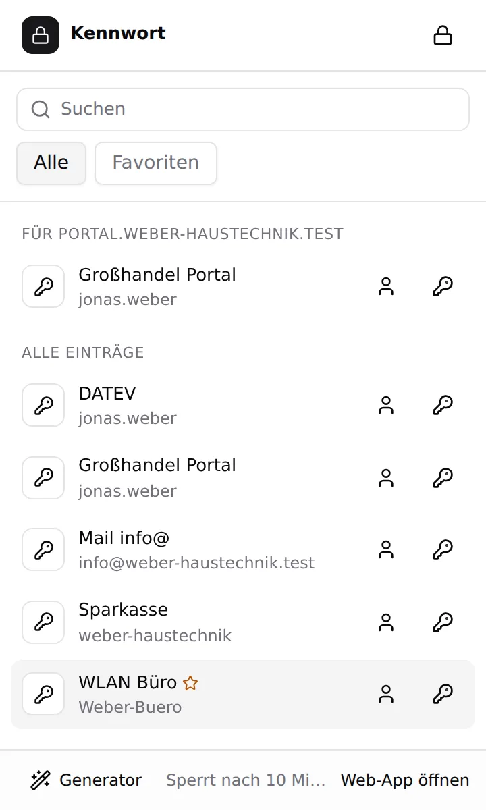

# Kennwort – alle Funktionen im Detail

**Die Zugänge deines Teams – nur für euch lesbar, auf deinem eigenen Server.**

Kennwort ist ein selbst gehosteter Passwortmanager für kleine Betriebe: Tresore und Gruppen fürs
Team, eine Browser-Extension, die erst nach Klick ausfüllt, und eine Web-App fürs Handy.
Ende-zu-Ende-verschlüsselt, mit Post-Quanten-Schutz, Open Source und ohne Kosten pro Benutzer.

<a href="/demo/" class="md-button md-button--primary">Demo ausprobieren</a>
[Installieren](installation.md){ .md-button }

!!! warning "Noch nicht veröffentlicht"
    Kennwort ist gebaut, aber noch ohne externes Audit; die App für Android ist eine Alpha ohne
    Release, die iOS-App fehlt noch. Bitte
    noch keine echten Passwörter damit verwalten. In der Demo gibst du ohnehin nur Testdaten ein.

!!! tip "Ausprobieren ohne Server"
    Die [Demo](https://kennwort.app/demo/) zeigt die Web-App mit der Beispielfirma „Weber
    Haustechnik“ (Jonas, Anna, Sandra und Max). Sie läuft ganz in deinem Browser: Ein Ersatz für den
    Server hält die verschlüsselten Daten nur im Speicher des Tabs, beim Neuladen beginnt alles von
    vorn, und die Seite darf keinen Server erreichen (CSP `connect-src 'none'`). Die Verschlüsselung
    ist dieselbe wie in der echten App, auch Argon2id mit den festen Parametern; deshalb dauert das
    Entsperren ein, zwei Sekunden. Die Passphrase steht oben auf der Seite und ist absichtlich
    schwach. Entsperren kann nur Jonas; Anna, Sandra und Max sind bestätigte Mitglieder, deren
    Passphrase niemand kennt. Gib dort keine echten Passwörter ein.

## Was Kennwort kann

- **Tresore fürs Team**: Logins, Notizen, WLAN, Karten, SSH- und API-Schlüssel, Einmal-Codes und
  Passkeys in [Tresoren](tresore.md) mit Gruppen, Rollen und Zugriff auf Zeit.
- **Entsperren mit Passkey oder Passphrase**: in der Web-App mit einem Passkey (WebAuthn PRF) oder
  mit Passphrase und Secret Key, die das Gerät nie verlassen ([Kryptografie](kryptografie.md)); dazu
  Recovery-Kit, Firmen-Recovery und Notfallzugriff ([Konto und Entsperren](konto.md)).
- **Browser-Extension**: Treffer nur für den exakten Host, Ausfüllen erst nach deinem Klick,
  Speichern neuer Logins, Phishing-Warnung und Passkeys ([Browser-Extension](extension.md)).
- **Für Handwerk und IT-Dienstleister**: QR-Etiketten für Geräte, Übergabe an den Kunden, mehrere
  Firmen in einem Konto ([Handwerk und IT-Dienstleister](handwerk.md)).
- **Im Alltag sicher**: [Sicherheits-Übersicht](sicherheit.md) mit schwachen, doppelten und
  geleakten Passwörtern, [Einmal-Links](einmal-links.md) für Externe, [Mitteilungen](mitteilungen.md)
  und eine [Kommandozeile](cli.md).
- **Umzug in Minuten**: Import aus Bitwarden, 1Password, LastPass, KeePass, Team Password Manager,
  Passbolt und den Browsern, direkt auf deinem Gerät ([Import und Export](import-export.md)).

## Rundgang

Die Web-App zeigt am Rechner Liste und Eintrag nebeneinander, mit der Seitenleiste für Tresore (dein
persönlicher zuerst, dann die geteilten mit der Zahl ihrer Personen); am Handy einen Bildschirm nach
dem anderen mit der Tab-Leiste unten. Die Navigation hat fünf Punkte: Einträge, Generator, Team
(Mitglieder, Gruppen und Tresore auf einer eigenen Seite), Einstellungen und Mitteilungen; unten am
Rand **Sperren** (Strg+L) und dein Konto ([Handy und App](handy.md)). Die
Extension öffnet ein Popup mit den Treffern der Seite und legt ein Menü unter Login-Felder. Am
schnellsten siehst du es in der <a href="/demo/">Demo</a>.

<picture>
  <source media="(prefers-color-scheme: dark)" srcset="assets/screenshots/entry-desktop-dark.webp">
  
</picture>

Die Tresore, die Mitglieder, die Sicherheit und die Mitteilungen der Firma:

<picture>
  <source media="(prefers-color-scheme: dark)" srcset="assets/screenshots/vaults-desktop-dark.webp">
  
</picture>
<picture>
  <source media="(prefers-color-scheme: dark)" srcset="assets/screenshots/members-desktop-dark.webp">
  
</picture>
<picture>
  <source media="(prefers-color-scheme: dark)" srcset="assets/screenshots/security-desktop-dark.webp">
  
</picture>
<picture>
  <source media="(prefers-color-scheme: dark)" srcset="assets/screenshots/notifications-desktop-dark.webp">
  
</picture>

Am Handy und im Popup der Extension (360 × 600):

<picture>
  <source media="(prefers-color-scheme: dark)" srcset="assets/screenshots/entries-phone-dark.webp">
  
</picture>
<picture>
  <source media="(prefers-color-scheme: dark)" srcset="assets/screenshots/entry-phone-dark.webp">
  
</picture>
<picture>
  <source media="(prefers-color-scheme: dark)" srcset="assets/screenshots/security-phone-dark.webp">
  
</picture>
<picture>
  <source media="(prefers-color-scheme: dark)" srcset="assets/screenshots/popup-extension-dark.webp">
  
</picture>

## Was Kennwort verspricht

Kennwort ist gegen einen Server gebaut, der selbst angegriffen wird:

- **Der Server sieht nur Verschlüsseltes.** Verschlüsselt wird auf deinem Gerät, mit
  XChaCha20-Poly1305, X25519 und ML-KEM-768 gegen künftige Quantencomputer, Ed25519 und Argon2id.
  Passphrase und Schlüssel verlassen das Gerät nie.
- **Niemand bekommt heimlich Zugriff.** Jede Mitgliedschaft ist unterschrieben, jeder Geheimtext an
  Eintrag, Tresor und Version gebunden; dein Gerät prüft beides. Alle 27 Angriffe der ETH-Studie zu
  Passwortmanagern mit bösartigem Server laufen als Tests.
- **Updates nur signiert.** Die installierte Web-App nimmt nur vom Kennwort-Projekt signierte
  Versionen an, auch wenn dein Server etwas anderes ausliefert.
- **Ausfüllen nur nach Klick**, nur auf dem exakten Host und nie in fremde iFrames.
- **Offen und prüfbar.** Quellcode unter AGPL-3.0, reproduzierbare Builds, eine Handvoll
  Abhängigkeiten im Client.

Die Einzelheiten stehen im [Sicherheitsdesign](sicherheitsdesign.md), was der Server über dich
speichert unter [Datenschutz](datenschutz.md).

## Installation

Ein Container mit Caddy davor für TLS, mit Docker Compose oder Podman Quadlet:

```sh
curl -fsSLO https://raw.githubusercontent.com/Speicherstadt/kennwort/main/docker/compose.yaml
curl -fsSLO https://raw.githubusercontent.com/Speicherstadt/kennwort/main/docker/Caddyfile
curl -fsSL -o .env https://raw.githubusercontent.com/Speicherstadt/kennwort/main/docker/kennwort.env.example
# KENNWORT_DOMAIN, KENNWORT_AUTH_SECRET und KENNWORT_SETUP_CODE in .env eintragen
docker compose up -d
```

Danach legst du mit dem Einrichtungs-Code deine Firma an. Alles Weitere: [Installation](installation.md),
[Backups](backup.md), [Updates](updates.md) und [Verwaltung](verwaltung.md).

## Fragen

Kosten, Umzug, vergessene Passphrase: Antworten stehen in der [FAQ](faq.md).
